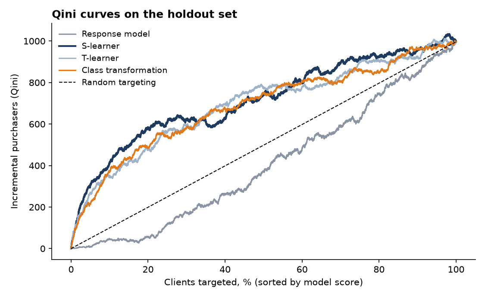
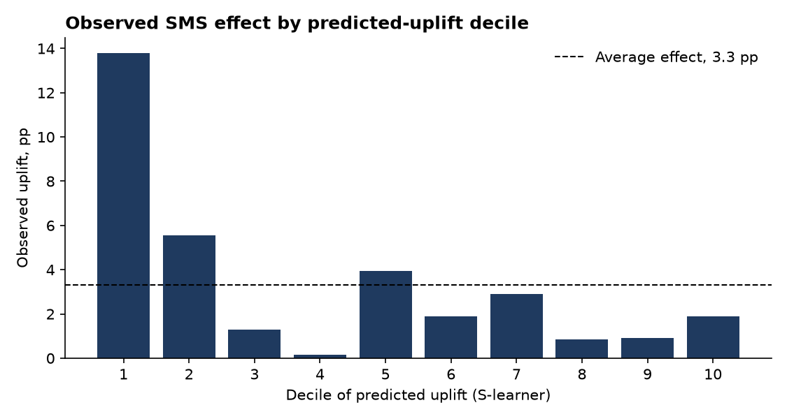
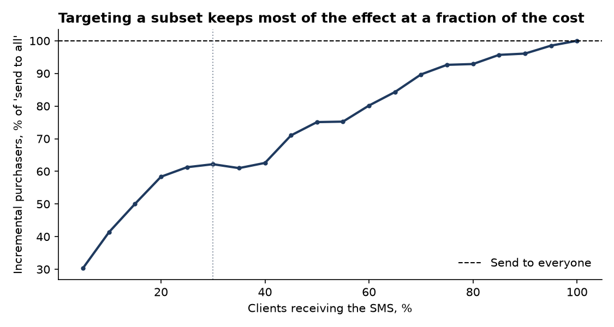
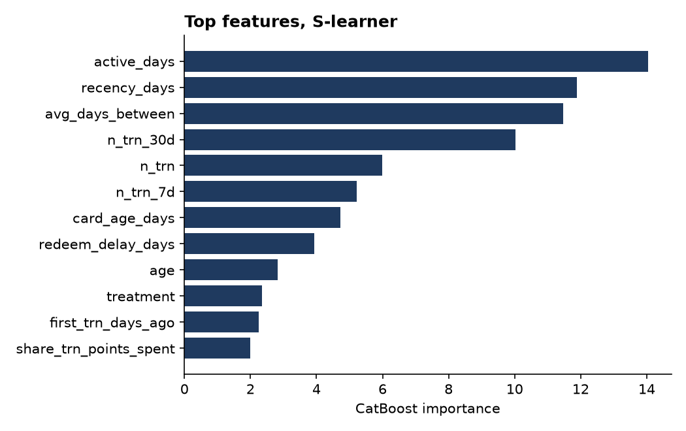

# Uplift Modeling for SMS Targeting (X5 RetailHero)

**English** · [Русский](README.ru.md)

**Question:** which loyalty-program clients should receive a promotional SMS? Not the ones most likely to buy, but the ones whose probability of buying **increases because of the SMS**.

**Stack:** DuckDB (feature engineering on 45.8M rows) · Python · CatBoost · scikit-uplift · scikit-learn · matplotlib

**Data:** [X5 RetailHero Uplift Modeling](https://ods.ai/competitions/x5-retailhero-uplift-modeling) — a randomized SMS campaign by X5 Group: 200,039 clients with treatment/control flag and purchase outcome, plus purchase history before the campaign (45,786,568 receipt lines, 8,045,229 receipts, 400,162 clients).

---

## Results

5 repeated stratified 70/30 splits; holdout metrics, mean ± std. Figures and per-decile numbers are from the first split.

| Model | uplift@30% | Qini AUC | Uplift AUC |
|---|---:|---:|---:|
| Response model (predicts P(purchase), ignores treatment) | 2.19 ± 0.32 pp | −0.0069 ± 0.0019 | −0.0108 ± 0.0030 |
| **S-learner** | **6.73 ± 0.20 pp** | **0.0179 ± 0.0015** | **0.0274 ± 0.0021** |
| T-learner | 6.60 ± 0.26 pp | 0.0153 ± 0.0011 | 0.0230 ± 0.0016 |
| Class transformation | 6.49 ± 0.58 pp | 0.0159 ± 0.0010 | 0.0242 ± 0.0016 |
| *Random targeting (average effect)* | *3.32 pp* | *0* | *0* |

**Key findings**

1. **The SMS works, but unevenly.** Average effect is +3.3 pp (63.7% vs 60.3% buyers). Among the top 30% of clients ranked by the S-learner it is **+6.7 pp — 2× the average**; in the top decile, +13.8 pp.
2. **Targeting likely buyers is worse than random.** The response model has a negative Qini: clients who buy anyway are exactly those the SMS does not influence. This is the core reason to use uplift models instead of propensity models for campaigns.
3. **30% of messages capture 62% of the incremental purchasers.** Per 1,000 SMS: ~67 extra buyers in the top 30% vs ~33 when messaging everyone.
4. **No "sleeping dogs" in this campaign.** Observed uplift is non-negative in every decile, so if SMS were free, messaging everyone would maximize incremental buyers. The case for targeting is cost: send to the top-k as long as uplift × margin per purchase exceeds the cost per contact.
5. **Simple S-learner wins** here; differences between uplift approaches (≈0.2 pp at 30%) are small relative to their gap from the response model (≈4.5 pp).







## Features

33 client-level features, all computed from purchases **before** the campaign (no target leakage), in a single DuckDB SQL script (`src/features.sql`, ~25 s on a laptop with 8 GB RAM — the 670 MB gzipped CSV is streamed, not loaded into memory):

- **RFM and activity:** number of receipts, total and average spend, recency, active days, average days between purchases, activity in the last 7/30 days, share of spend in the last 30 days
- **Basket:** lines and items per receipt, unique products, number of stores
- **Loyalty program:** regular/express points received and spent, share of receipts paid with points, card age, delay between card issue and first redemption
- **Demographics:** age (cleaned: values outside 14–100 set to missing), gender



> In an S-learner, feature importance mostly reflects what predicts *purchase*, not *uplift*; it is shown for context, not as a causal explanation.

## Methods

- **Response model:** P(Y=1 | X), the usual "propensity to buy" — baseline.
- **S-learner:** one model P(Y=1 | X, W); uplift = f(X, 1) − f(X, 0).
- **T-learner:** separate models on treatment and control; uplift = f₁(X) − f₀(X).
- **Class transformation:** Z = Y·W + (1−Y)(1−W); with a 50/50 split, uplift = 2·P(Z=1 | X) − 1.
- **Metrics:** uplift@30% — difference in purchase rate between treatment and control within the top 30% (computed per group); Qini AUC and uplift AUC — area between the model's curve and random targeting.

## Project structure

```
src/
  features.sql        feature engineering in DuckDB (receipt lines → receipts → clients)
  build_features.py   runs features.sql → data/features.parquet
  train.py            4 models × 5 splits, metrics, figures → reports/
reports/
  results.json        summary metrics and business numbers
  cv_results.csv      metrics for every model and split
  figures/
```

## Running locally

```bash
python3 -m venv .venv && source .venv/bin/activate
pip install -r requirements.txt
mkdir -p data && for f in clients.csv.gz uplift_train.csv.gz purchases.csv.gz; do
  curl -L -o data/$f https://sklift.s3.eu-west-2.amazonaws.com/$f; done   # ~680 MB
python src/build_features.py
python src/train.py      # ~5 min
```

## Limitations

- The SMS campaign is a single randomized experiment; uplift estimates may not transfer to other offers, channels or seasons.
- No contact cost or margin data is available, so the economic effect is expressed in incremental buyers, not rubles.
- Hyperparameters are fixed (CatBoost, 400 trees, depth 6) and not tuned per approach; tuning could change the ranking between uplift models, which are already close.
- The target is binary (purchase / no purchase); revenue uplift would require a different target.
